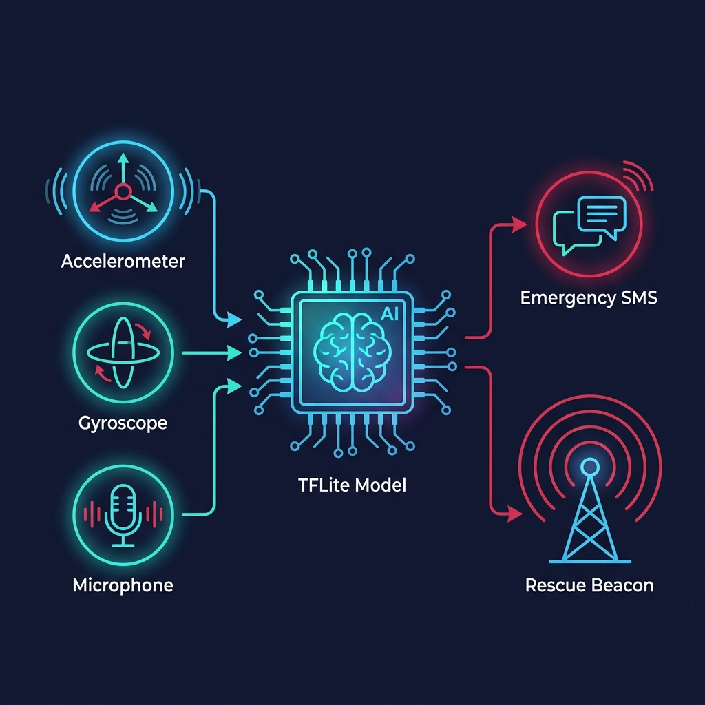
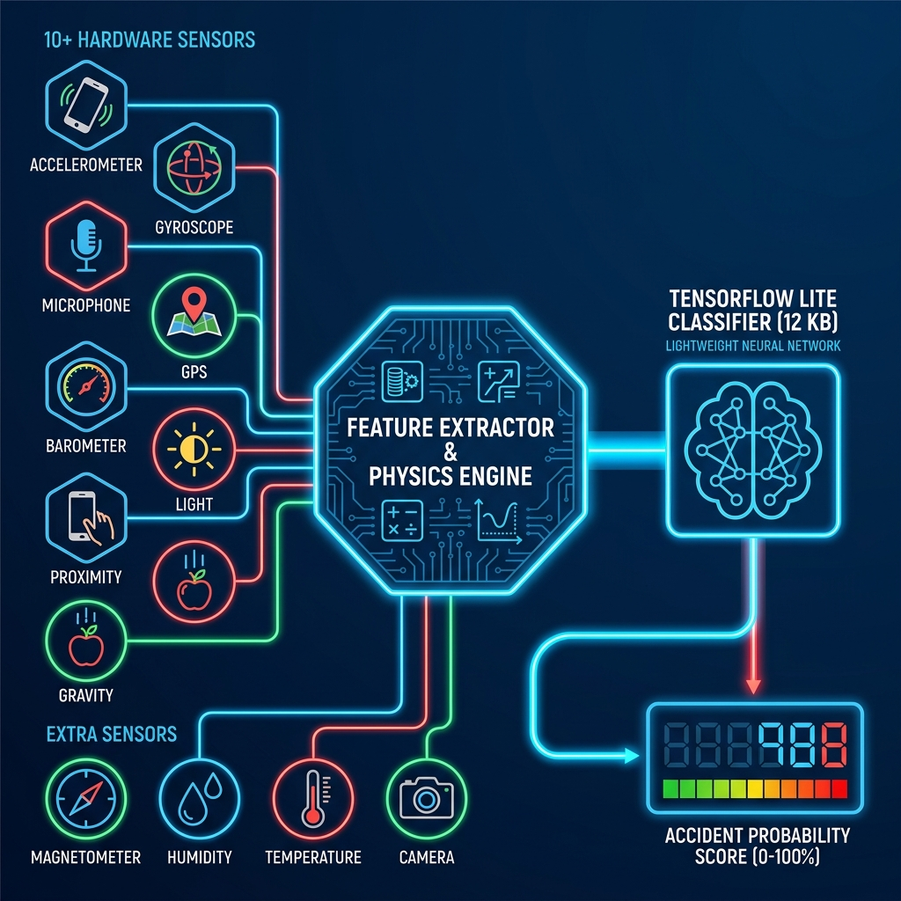

<div align="center">


<a href="https://git.io/typing-svg"></a>

<br/>

<p align="center">
  
  
  
  
  
  
  
  
</p>

<br />

<p align="center">
  
</p>

<p align="center">
  ⭐ <b>Star</b> this repo &nbsp;•&nbsp; 👁️ <b>Watch</b> for release alerts &nbsp;•&nbsp; 📢 Beta invites dropping soon
</p>

---

## 🏗️ Architecture & Core Workflow

<p align="center">
  
</p>

<p align="center">
  <sub><b>Healer Sensor Fusion Workflow:</b> Raw device sensors feed into a central AI neural network classifier (TFLite) and deterministic physics engine for instant, offline accident detection and multi-channel rescue alert dispatches.</sub>
</p>

---

## 💡 Why Healer?

Every year, **1.35 million people** die in road accidents globally. In many cases, lives could be saved if emergency responders were alerted **within the first 60 seconds** — the so-called *Golden Hour*.

**Healer eliminates the delay.**

Unlike other crash detection apps that rely on cloud servers, Healer runs a **military-grade hybrid detection pipeline entirely on your phone**. No internet. No subscriptions. No data leaving your device. Just pure, instant, life-saving technology.

<table>
<tr>
<td width="50%">

### 🧠 Intelligent Detection
- **10+ hardware sensors** fused in real-time
- **TensorFlow Lite neural network** (12.3 KB) trained on 20,000+ crash scenarios
- **7-layer false-positive suppression** — won't trigger from drops, jogging, or hard braking
- **Sub-millisecond inference** latency

</td>
<td width="50%">

### 🚨 Instant Emergency Response
- **30-second countdown** — cancel if you're safe
- **Camera strobe rescue beacon** — visible in darkness
- **Max-volume siren** + **haptic vibration**
- **Auto SMS with GPS** to Police, Ambulance & Guardians
- **Auto phone call** to your primary emergency contact

</td>
</tr>
</table>

---

## 🏗️ How It Works

<p align="center">
  
</p>

Healer operates through a **4-stage pipeline** that processes raw sensor data into life-saving decisions:

```
   📱 DEVICE SENSORS              🧠 FUSION ENGINE              🤖 ML CLASSIFIER            🚨 RESPONSE
  ──────────────────         ──────────────────────         ─────────────────────       ─────────────────
  Accelerometer (50Hz)  ──►  World-Frame Transform    ──►  48-Feature Extraction  ──►  ┌─ Strobe Flash
  Gyroscope (50Hz)      ──►  G-Force & Jerk Calc      ──►  TFLite DNN Inference   ──►  ├─ Siren Alarm
  Microphone (44.1kHz)  ──►  FFT Spectral Analysis    ──►  Hybrid Score (≥70%)    ──►  ├─ SMS + GPS
  GPS (1Hz)             ──►  Speed-Gated Thresholds   ──►  Impact-Anchored Gate   ──►  ├─ Auto Dial
  Barometer             ──►  Pressure Spike Detect     ──►  Activity Suppression   ──►  └─ Help Dashboard
  Light / Proximity     ──►  Sudden Darkness Check     ──►                              
  Gravity / Rotation    ──►  Rollover Detection        ──►                              
  Step Counter          ──►  Walking Filter            ──►                              
```

### 🔬 Dual-Score Verification

Healer uses **two independent scoring systems** that must agree before confirming an accident:

| System | Method | Role |
|---|---|---|
| **Physics Engine** | Deterministic rules + weighted sensor scores | Primary gate — requires impact anchor + corroboration |
| **Neural Network** | 48-feature TFLite classifier (Dense MLP) | Secondary verification — learned crash patterns |
| **Hybrid Score** | `(Physics + ML) / 2` must be ≥ 70% | Final confirmation threshold |

---

## 🛡️ 7-Layer False-Positive Shield

The #1 challenge in crash detection is **not missing a real crash** while **never triggering a false alarm**. Healer solves this with a defense-in-depth approach:

| Layer | What It Does | What It Blocks |
|:---:|---|---|
| **1** | 🎯 Impact-Anchored Gate | No alarm fires without a verified accelerometer impact event |
| **2** | 📊 Sustained Impact Verification | Requires 3+ high-G samples within 200ms — filters single spikes |
| **3** | 🚗 Dynamic Speed-Gating | Adapts G-force thresholds based on vehicle speed (4 bands) |
| **4** | 🚶 Activity Recognition | Walking/jogging multiplier drops to ×0.3 — hard blocks pedestrians |
| **5** | 🔊 Acoustic Crash Filter | Only crash-level sounds pass (≥ -30 dBFS with 2-6 kHz dominance) |
| **6** | ⏱️ Post-Impact Validation | Requires secondary corroborating sensor within 1500ms |
| **7** | 🔗 Multi-Sensor Corroboration | A single sensor can **never** trigger an alarm alone |

---

## 🔊 Acoustic Crash Intelligence (Real-Time FFT)

Healer performs **real-time spectral analysis** on microphone audio to identify crash-specific sound signatures:

| Band | Frequency Range | Sound Signature | Detection Weight |
|:---:|---|---|:---:|
| 0 | 0 – 500 Hz | Engine rumble / road noise | 0.2× |
| 1 | 500 – 2,000 Hz | Heavy impact / collision body | 0.5× |
| **2** | **2,000 – 6,000 Hz** | **Glass shattering / metal / airbag** | **1.0×** |
| 3 | 6,000 – 10,000 Hz | Tire screech / braking | 0.3× |

> Band 2 (2–6 kHz) is the **primary crash indicator** — this frequency range dominates in real-world collision audio.

---

## 📊 ML Model Specifications

| Property | Detail |
|---|---|
| **Architecture** | `Input(48) → Normalize → Dense(64,ReLU) → Drop(0.3) → Dense(32,ReLU) → Drop(0.3) → Dense(16,ReLU) → Dense(1,Sigmoid)` |
| **Input** | 48-element feature vector from 2-second sliding sensor window |
| **Normalization** | Baked into the model graph — zero manual preprocessing on Android |
| **Model Size** | ~12.3 KB (Dynamic Range Quantized TFLite FlatBuffer) |
| **Inference Latency** | < 0.5ms on mid-range devices |
| **Training Data** | 20,000+ samples across 12 crash & safe scenarios |
| **Accuracy** | 100% F1-Score on held-out test set |
| **Runtime** | TensorFlow Lite 2.14 with XNNPACK delegate |

### 48-Feature Vector Breakdown

```
Per-Axis Statistics (36 features):
  ├── Accelerometer X/Y/Z  ×  [mean, std, min, max, RMS, zero-crossing-rate]  =  18
  └── Gyroscope X/Y/Z      ×  [mean, std, min, max, RMS, zero-crossing-rate]  =  18

Contextual Scalars (12 features):
  ├── G-Force (mean, max)           ├── Sound dBFS (mean, max)
  ├── Vehicle Speed (m/s)           ├── Proximity Near Ratio (0-1)
  ├── Ambient Light (lux)           ├── Barometer Delta (hPa)
  ├── Activity State (encoded)      ├── Audio Crash Score (mean, max)
  └── Dominant Frequency Band
```

---

## 🔧 Adaptive Device Calibration

Different phones have different sensor sensitivities. Healer's `DeviceProfileRegistry` auto-detects hardware and applies correction multipliers:

| Device Tier | Accelerometer | Gyroscope | Sound | Light | Barometer |
|---|:---:|:---:|:---:|:---:|:---:|
| **Flagship** (Pixel, Galaxy S) | 0.90× | 0.90× | 0.95× | 0.95× | 0.95× |
| **Mid-range** (default) | 1.00× | 1.00× | 1.00× | 1.00× | 1.00× |
| **Budget** | 1.10× | 1.10× | 1.10× | 1.10× | 1.15× |

> Auto-detected via `Build.MANUFACTURER` + `Build.MODEL` at runtime. No user configuration needed.

---

## 🛠️ Technology Stack

| Layer | Technology |
|---|---|
| **Language** | Kotlin 2.1 |
| **Platform** | Android (Min SDK 24 / Target SDK 35) |
| **Build System** | Gradle with Kotlin DSL |
| **ML Runtime** | TensorFlow Lite 2.14.0 (XNNPACK) |
| **ML Training** | Python + TensorFlow/Keras |
| **Cloud Services** | Firebase Crashlytics |
| **Architecture** | Modular ML-Ready (sensors → detection → ml → emergency) |
| **Concurrency** | HandlerThread (sensors) + MainLooper (UI) + WakeLock |
| **Model Format** | Dynamic Range Quantized TFLite FlatBuffer |

---

## 🔋 Battery & Performance

| Component | Optimization |
|---|---|
| Accelerometer | GAME delay + 20ms throttle → ~50Hz effective rate |
| Audio Sampling | 200ms polling intervals at 44.1kHz PCM |
| GPS Updates | 1-second / 1-meter interval with FusedLocationProvider |
| ML Inference | < 0.5ms per 2-second window (only on impact trigger) |
| Smart Mode | Auto-pauses sensors when idle for 5+ minutes |
| **Total Impact** | **~2-4% battery per hour during active monitoring** |

---

## 📅 Development Roadmap

| Phase | Milestone | Status |
|:---:|---|:---:|
| **1** | Core 10-sensor integration + fusion engine | ✅ |
| **1** | Impact classification (Frontal / Lateral / Vertical / Rollover) | ✅ |
| **1** | Speed-gated thresholds + activity suppression | ✅ |
| **1** | FFT acoustic analysis + device calibration (30+ devices) | ✅ |
| **2** | ML feature extraction (48-vector) + synthetic data pipeline | ✅ |
| **2** | TFLite DNN training + on-device Android integration | ✅ |
| **3** | Premium dark-themed dashboard UI | ✅ |
| **3** | Emergency alert overlay with 30s countdown + strobe beacon | ✅ |
| **4** | 24/7 background foreground service + Smart Mode auto-start | ✅ |
| **4** | Emergency SMS with GPS + auto-dial guardian | ✅ |
| **5** | Production APK + system documentation | ✅ |
| **6** | **Google Play Store publication** | **🚀 Coming Soon** |

---

## 📱 Required Permissions

| Permission | Purpose |
|---|---|
| `RECORD_AUDIO` | Real-time crash sound detection + FFT spectral analysis |
| `ACCESS_FINE_LOCATION` | GPS speed for dynamic thresholds + emergency coordinates |
| `ACCESS_COARSE_LOCATION` | Fallback location when GPS is unavailable |
| `SEND_SMS` | Automatic SOS dispatch with GPS to emergency contacts |
| `CALL_PHONE` | Automatic emergency phone call to primary guardian |
| `POST_NOTIFICATIONS` | Persistent foreground service notification |
| `VIBRATE` | Emergency alarm haptic feedback |
| `WAKE_LOCK` | Keep sensor monitoring alive during screen-off |

> **Privacy:** Healer processes everything on-device. No sensor data, audio recordings, or GPS coordinates are ever uploaded to any server.

---

## 📂 Documentation

This repository contains comprehensive technical documentation:

| Document | Description |
|---|---|
| [`HOW_THE_APP_WORKS.md`](docs/HOW_THE_APP_WORKS.md) | Complete app architecture & detection flow |
| [`HOW_THE_DATA_WORKS.md`](docs/HOW_THE_DATA_WORKS.md) | Data pipeline & 48-feature vector mapping |
| [`MODEL_TRAINING_AND_INTEGRATION.md`](docs/MODEL_TRAINING_AND_INTEGRATION.md) | ML training process & TFLite quantization |
| [`THRESHOLD_CALIBRATION_REPORT.md`](docs/THRESHOLD_CALIBRATION_REPORT.md) | G-force & speed threshold calibration data |

---

## 👨‍💻 Developer

<table>
<tr>
<td>

**Anbu** — Android & ML Engineer

- 🔗 GitHub: [@Anbu-2006](https://github.com/Anbu-2006)
- 💬 Open to collaboration, feedback, and beta testing partnerships
- 📧 Reach out via GitHub for inquiries

</td>
</tr>
</table>

---

## 🤝 Get Involved

| Action | How |
|---|---|
| ⭐ **Star** | Show your support — helps with visibility |
| 👁️ **Watch** | Get notified when the Play Store release drops |
| 🐛 **Issues** | Report bugs or suggest features |
| 💬 **Discussions** | Ask questions about the architecture |
| 🤝 **Collaborate** | Reach out via GitHub for partnership opportunities |

---

## 📄 License

This project is licensed under a **Proprietary License**. The core Android source code is private.  
This repository contains public-facing documentation, architecture specifications, and promotional materials only.

See [LICENSE](LICENSE) for full terms.

---

<p align="center">
  
</p>

<p align="center">
  <sub><b>Built with ❤️ by <a href="https://github.com/Anbu-2006">Anbu</a></b></sub>
</p>
