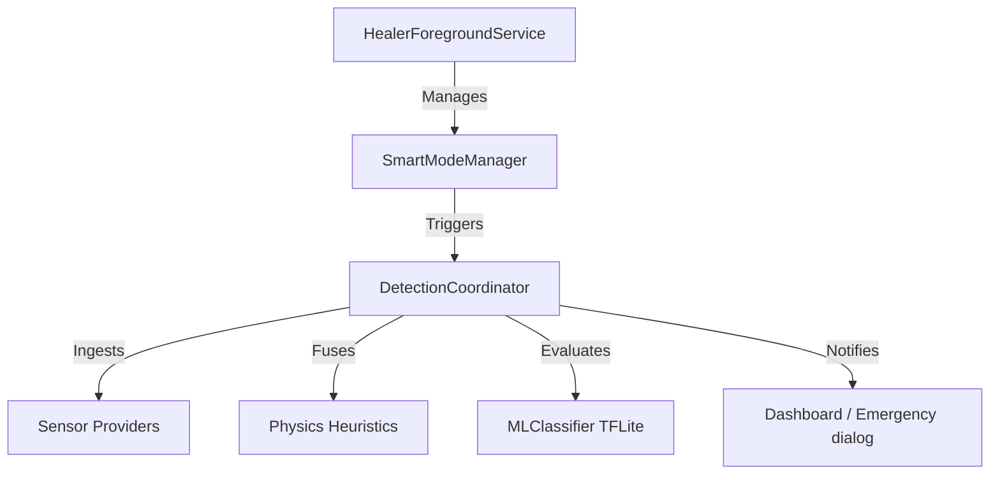

# Healer App — How the App Works

This document explains the runtime architecture and detection flow of the Healer Android application, detailing how background monitoring, sensor fusion, and emergency triggers work in unison.

---

## 🏗️ Architecture Overview

The Healer app is built around a low-power, offline-first background service. The detection pipeline flows from raw hardware sensor inputs up to MVVM UI screens:

---

## 🔄 Core Components

### 1. Foreground Service (`HealerForegroundService`)
* **Purpose:** Ensures the application is not terminated by Android's strict background limitations (OOM killer).
* **Execution:** Displays a persistent notification to the user, asserting background processing permission.
* **Smart Toggling:** Starts and stops the active sensor listener thread based on commands received from the `SmartModeManager`.

### 2. Smart Mode Manager (`SmartModeManager`)
* **Purpose:** Optimizes battery consumption by only running high-frequency sensor loops when the user is driving.
* **Execution:**
  * Uses the low-power `ActivityDetector` to monitor step rates and device orientation.
  * When `IN_VEHICLE` activity is detected, it signals `HealerForegroundService` to start the full `DetectionCoordinator` engine.
  * When `STILL` or `WALKING` is detected, it turns off the Active Engine, putting the app into low-power standby mode.

### 3. Detection Coordinator (`DetectionCoordinator`)
* **Purpose:** The central sensor fusion brain. It coordinates all sensor streams, manages a 2-second circular snapshot buffer, and evaluates impact confidence.
* **Sensors Managed:**
  1. **Accelerometer:** G-force peaks and impact vector direction.
  2. **Gyroscope:** Angular rotation speed (rollover detection).
  3. **Sound Recorder:** Real-time audio analysis via Fast Fourier Transform (FFT).
  4. **Barometer:** Altitude/pressure changes (airbag deployment marker).
  5. **Light Sensor:** Sudden darkness checks (e.g. glovebox, pocket, or dust).
  6. **Proximity Sensor:** Distance to screen (helps filter phone drops).
  7. **GPS / Location:** Current velocity for speed-band thresholding.
  8. **Gravity Provider:** Rotational vector checks to monitor vehicle flips.

### 4. Machine Learning Engine (`MLClassifier`)
* **Purpose:** Runs inference on-device using the optimized TensorFlow Lite model (`healer_model.tflite`).
* **Trigger:** To conserve CPU cycles, the ML engine only executes inference if the physics heuristic score is greater than zero (i.e. an impact is physically detected).

---

## 🛡️ False-Positive Suppression System (7 Layers)

Because false alarms can cause unnecessary panic, the app employs a 7-layer safety guard:

| Layer | Component | Mechanism | What it Blocks |
| :--- | :--- | :--- | :--- |
| **1** | **Impact Anchoring** | `ShakeDetector` must register a high-G acceleration event first. | Random background calculations. |
| **2** | **Sustained Impact Gate** | Requires multiple G-spikes within a 200ms window rather than a single spike. | Simple phone drops or bumps. |
| **3** | **Speed Gating** | Threshold limits dynamically scale based on GPS speed band. | Hard braking at slow speeds. |
| **4** | **Activity Suppression** | If `ActivityDetector` reports `WALKING` or `RUNNING`, the confidence is heavily penalized. | Jogging, running, or walking bumps. |
| **5** | **Sound Level Gating** | Sound provider filters out audio below -50 dBFS. | Normal conversation and music. |
| **6** | **Post-Impact Validation** | Verifies that a brief period of secondary motion occurs after the crash (user movement). | Static drops. |
| **7** | **Multi-Sensor Pair** | Accident is never declared based on a single sensor reading; at least two sensors must correlate. | Single sensor malfunctions. |

---

## 🚨 Emergency Trigger Workflow

When the hybrid probability score exceeds **70%**, Healer immediately launches the emergency confirmation sequence:

### Step 1: Intense Multi-Sensory Alerting
To grab the user's attention (even if they are dazed or the phone is in a dark/low-light cabin), the app triggers:
1. **Siren Sound:** Plays the system alarm sound loop at maximum volume (overriding silent mode).
2. **Violent Vibration:** Triggers a repeating strong vibration pattern (vibrate 500ms, pause 200ms).
3. **High-Visibility Strobe Flash:** Rapidly toggles the device's camera LED flash (on/off every 300ms) to act as a rescue beacon in low-light environments.
4. **Vibrant Red Screen Overlay:** Launches the fullscreen `EmergencyAlertActivity` with an intense neon red linear gradient background, high-contrast white readout texts, and a glowing neon circular "I'M SAFE" cancel button.

### Step 2: 30-Second Countdown
A 30-second countdown timer runs on the screen, scaling dynamically on each tick to remain visible.

### Step 3: Cancellation vs. Confirmation
* **If the User is Safe (Cancellation):** 
  * The user taps the large circular **"I'M SAFE"** button.
  * The app instantly silences the siren, stops the vibration, kills the flashlight strobe, and resets the background monitoring engine to normal. The incident is dismissed as a false alarm.
* **If the User does not Respond (Confirmation):**
  * If the 30-second timer runs down to 0, Healer **confirms the accident**.
  * The background service automatically triggers the `EmergencyResponder` to send SMS messages containing the exact GPS location to the configured contacts (including Police, Ambulance, and Guardian). It also initiates an emergency voice call to the primary contact.

### Step 4: Help Dispatched Overlay Dashboard
Once the alerts are transmitted, the fullscreen activity UI transitions dynamically:
* The siren, vibration, and camera strobe are silenced.
* The countdown warning UI hides itself.
* A green-accented **SOS Alerts Transmitted** status dashboard appears, detailing exactly who was contacted:
  * **🚔 Police (100):** Location and SOS telemetry sent.
  * **🚑 Ambulance (108):** Medical emergency request dispatched.
  * **🛡️ Guardians:** SMS alert sent and phone call initiated.
* The current GPS coordinates remain displayed at the bottom.
* The dashboard stays visible to serve as visual confirmation for the user or emergency responders.
* The user can dismiss the screen by clicking the green **"I AM OKAY NOW (CLOSE)"** button, which safely returns the app to its active monitoring state.
